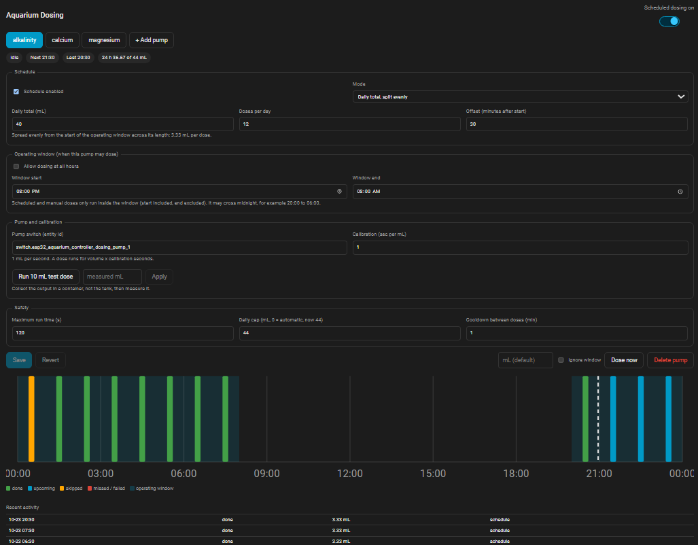
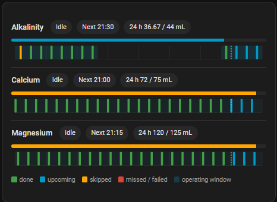

# Aquarium Dosing for Home Assistant

Scheduled, safety-checked dosing pumps, run entirely inside Home Assistant: no
automations, no helpers per pump, no cloud.

- Per-pump schedule in three modes: **interval**, **fixed times**, or a **daily total**
  split evenly
- A per-pump **operating window**: a pump (say alkalinity) only dosed during the hours
  you choose, for scheduled *and* manual doses
- Exactly-once dosing that survives restarts, and never "catches up" a missed dose
- Run-time cap, rolling 24 h cap, cooldown, confirmed switch-off and a fault latch
- Calibration wizard and priming
- Every setting is an entity; two Lovelace cards (editor and summary)

Requires Home Assistant **2024.11 or newer**.

---

## Install

### 1. Get the files

**HACS (recommended):** HACS → ⋮ → **Custom repositories**, add this repository's URL
with category **Integration**, download **Aquarium Dosing**, restart Home Assistant.

**Manual:** copy `custom_components/aquarium_dosing/` into
`<config>/custom_components/aquarium_dosing/` and restart.

### 2. Set up

1. **Create the master toggle** (one per aquarium): **Settings → Devices & services →
   Helpers → Create helper → Toggle**, for example `Aquarium Dosing`
   (`input_boolean.aquarium_dosing`). ON allows scheduled dosing, OFF pauses it, for
   example during a water change.
2. **Settings → Devices & services → Add integration → Aquarium Dosing.**
   - Step 1: aquarium name, the master toggle, "run one pump at a time", late-dose
     tolerance.
   - Step 2: name and switch of your first pump.
   - Run the integration again for another aquarium; each uses its own toggle.
3. Add the cards to a dashboard (see **Lovelace cards**), then add more pumps and set
   their schedules.
4. Turn on each pump's **Schedule enabled** and the master toggle. New pumps start with
   the schedule **off**.

**The cards load automatically.** On start the integration registers its script as a
dashboard resource (Settings → Dashboards → Resources shows
`/aquarium_dosing/aquarium-dosing-card.js?v=...`), updates it when you upgrade, and
removes it when you delete the integration. A resource you added by hand is updated, not
duplicated. If your dashboards use **YAML resource mode** this cannot be done from code:
add it to your dashboard YAML instead:

```yaml
lovelace:
  resources:
    - url: /aquarium_dosing/aquarium-dosing-card.js
      type: module
```

If a card still says "Custom element doesn't exist", restart Home Assistant and
hard-refresh the browser (Ctrl+Shift+R).

---

## How scheduling works

Each pump has one schedule mode.

| Mode | Doses |
|---|---|
| `interval` | First dose at the **window start** (midnight when all hours) **plus the offset**, then every N minutes while inside the window |
| `times` | Exactly the clock times you list; each must be inside the window |
| `daily_total` | The daily total divided into N equal doses, spaced evenly from the window start across the window (offset shifts the start) |

Offsets stagger pumps: calcium with offset 15 and alkalinity with offset 45 on an
hourly interval dose at :15 and :45, never together. With **all hours** on, an
interval must divide 24 h evenly (30, 60, 120, 180, 240, 360 ... minutes) so the
pattern is identical every day; inside a window any interval works and the pattern
restarts at the window start each day.

### Operating window

Each pump has **Operate at all hours** and, when that is off, a **window start** and
**window end**. Think "alkalinity only between 14:00 and 22:00 because of its effect
on pH".

- Doses only run inside the window. Start is included, end is excluded.
- The window may cross midnight (20:00 to 06:00).
- It applies to scheduled doses **and** the Dose now button / service. A manual dose
  outside the window is refused unless you tick **ignore window** (service field
  `ignore_window`). Priming and calibration are not subject to it.
- Fixed times outside the window are refused when you save, with the offending time
  named.
- The cards draw the window as a shaded band on the 24 h timeline.

### Exactly once, never caught up

- Each pass saves the last processed slot **before** running anything, so a restart
  cannot repeat a dose.
- A scheduled dose more than the **late tolerance** (default 5 minutes) late, for
  example after Home Assistant was down, is **skipped and logged**, never made up.
- Slots that pass while dosing is paused (master toggle off or the pump's schedule
  disabled) are skipped, so switching back on never fires a stale dose.
- Enabling a schedule or changing its shape starts "from now" for the same reason.

---

## Safety

Checked before every scheduled and manual dose:

| Check | Behaviour |
|---|---|
| **Fault** | A latched fault blocks everything for that pump until **Clear fault** |
| **Switch available** | An unavailable pump switch blocks the dose |
| **Operating window** | See above |
| **Maximum run time** | Default 120 s. A dose longer than this (volume x calibration) is refused. Saving a schedule or calibration that would exceed it is refused outright |
| **Cooldown** | Minimum gap between doses of the same pump (default 1 min) |
| **Daily cap** | Maximum volume per rolling 24 h. Automatic = 1.5x the scheduled daily total; set your own to override. A cap below the scheduled total is refused |

Calibration is limited to 0.1 to 600 sec/mL.

**Pump-off confirmation and faults.** After every run the integration switches the pump
off and *checks the switch state*, retrying up to three times. If it cannot confirm the
pump is off, the pump is **latched in a fault**, a persistent notification appears and
an event fires. Nothing runs on that pump until you check it and press **Clear fault**.

**Restarts.** An "in flight" record is saved before the pump starts. After a crash or
restart, any pump that was running is switched off and the interrupted dose counts in
full towards the daily cap (it is not retried). Unloading the integration also switches
a running pump off.

**One pump at a time** (default): doses wait for each other, so pumps sharing a power
supply never overlap. A dose that waited long enough to become late is skipped.

**Device-side failsafe.** Home Assistant cannot guarantee anything if it crashes
mid-dose, so the example in `esphome/dosing-pump.yaml` switches each pump off after a
fixed time on the device itself and starts every pump off after a reboot. Set that delay
slightly above your maximum run time.

---

## Calibration and priming

1. Put the pump output in a measuring container (**not the tank**).
2. Press **Calibration dose (10 mL)**. It runs 10 mL x the current calibration. It does
   not count towards daily totals and ignores the window.
3. Measure what came out and call **Apply** in the card, or the `aquarium_dosing.calibrate`
   service, with the measured mL.

The new value is `multiplier used for the test x 10 / measured`. It uses the multiplier
that was in force **when the test ran**, so editing the number in between cannot skew the
result. Unreasonable results (outside 0.1 to 600 sec/mL) are refused.

**Prime** is a switch that runs the pump for priming, up to its maximum run time or until
you switch it off. It takes the same lock as doses and cannot start during a fault.

---

## Entities

Each pump becomes a device (for example **Reef Alk pump**) with:

| Kind | Entities |
|---|---|
| `number` (config) | Dose volume, Calibration multiplier, Interval, Offset, Daily total, Doses per day, Daily cap (0 = automatic), Maximum run time, Cooldown |
| `time` (config) | Window start, Window end |
| `select` (config) | Schedule mode |
| `switch` | Schedule enabled and Operate at all hours (config); **Prime** |
| `button` | Dose now, Calibration dose (10 mL), Clear fault |
| `sensor` | Status, Last dose, Next dose, Delivered (24 h) |
| `binary_sensor` | Fault |

Entity ids are built from the aquarium name and pump (`number.reef_alk_pump_dose_volume`);
the device page shows the exact ids. Settings entities are views of the pump
configuration: changing one validates and saves everything, and refuses a change that
would make the pump unsafe or invalid (with the reason). **Fixed dose times** are edited
in the card.

Status values: `idle`, `disabled` (schedule off), `paused` (master toggle off), `queued`,
`dosing`, `priming`, `calibrating`, `fault`.

### Services

- `aquarium_dosing.dose`: target any entity of a pump; optional `volume` and
  `ignore_window`. All safety checks still apply (except the window if overridden).
- `aquarium_dosing.calibrate`: target any entity of a pump; `measured_ml`.

### Events

`aquarium_dosing_event` with `aquarium`, `pump` and `type`: `started`, `done`, `skipped`,
`failed`, `interrupted`, `calibration`, `prime`, `calibrated`, `fault`, `fault_cleared`
(plus `reason` or volumes where relevant). Use it for notifications, for example on
`fault`.

---

## Lovelace cards

Both cards are in one JavaScript file. With one aquarium no configuration is needed; with
several set `master_entity` to the aquarium's toggle.

```yaml
type: custom:aquarium-dosing-card          # editor, for a config dashboard
title: Dosing                              # optional
master_entity: input_boolean.reef_dosing   # optional with one aquarium
```

Pump tabs, schedule mode and fields, the operating window, calibration wizard, safety
limits, Dose now (with optional volume and "ignore window"), fault banner with **Clear
fault**, recent activity, and a 24 h timeline. With unsaved edits the timeline previews
your draft (computed by the same engine that runs the pumps); otherwise it shows today's
real outcomes (done, upcoming, skipped, missed or failed). Saving needs an admin user.



```yaml
type: custom:aquarium-dosing-summary-card  # compact, for a main display
title: Dosing                              # optional
master_entity: input_boolean.reef_dosing   # optional with one aquarium
pumps: [alk, ca]                           # optional: only these pumps
```

Status, next dose, delivered vs cap, and a timeline strip per pump.



---

## Files

```
custom_components/aquarium_dosing/
  manifest.json        integration metadata
  __init__.py          setup, services, registers the cards and websocket API
  dosing_engine.py     schedule, window and safety rules (pure Python, no HA imports)
  coordinator.py       scheduler, dose runner, persistent ledger, fault handling
  config_flow.py       setup + options flow
  entity.py            shared base for the pump entities
  number.py time.py select.py switch.py button.py sensor.py binary_sensor.py
  api.py               websocket API for the cards
  card_resource.py     serves the card script and registers it as a dashboard resource
  const.py, services.yaml, strings.json, translations/en.json
  frontend/aquarium-dosing-card.js   editor + summary cards
esphome/dosing-pump.yaml             example node with a device-side failsafe
tests/                               engine tests + real-Home-Assistant tests
```

## Limits and not yet included

- **Reservoir tracking** (volume remaining, low-level warning) and **interlocks** (block
  dosing while another entity is in a given state, such as a leak sensor or skimmer) are
  not in this version. The dose ledger already records what is needed for the former.
- Dose times within the minute are not supported; slots are on whole minutes.
- During a DST change the wall clock jumps, and a schedule jumps with it.
- Dose history is kept for 7 days (500 entries per pump) in Home Assistant's storage.
- This is software around a pump; it does not replace a mechanical or electrical
  protection layer for anything that could harm your tank if it ran away. Use the device
  failsafe and sensible caps.

## Tests

```bash
pip install pytest-homeassistant-custom-component   # needs Python 3.13+
pytest tests/
```

- `tests/test_dosing_engine.py`: schedule modes, window rules (including midnight
  crossing), exactly-once slot selection, safety checks, calibration maths. Also runs
  with plain `pytest`.
- `tests/test_integration.py`: real Home Assistant: entity creation, edits and refusals,
  exactly-once scheduled doses, late/paused skipping, operating window on manual doses,
  caps and cooldown, fault latching, restart recovery, one pump at a time, calibration,
  services and the websocket API.
